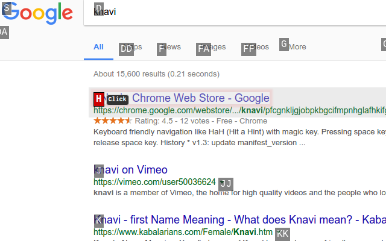

# knavi

A Hit-a-Hint Chrome extension. Hold Space, type a hint key, and release to click links and buttons without a mouse.

<a target="_blank" href="https://chrome.google.com/webstore/detail/knavi/pfcgnkljgjobpkbgcifmpnhglafhkifg"></a>

## Screenshot

Hints displayed:


Hit confirmed:



## Description

Click links and buttons with the keyboard only. Hold the Peek Key (Space by default), type the hint key shown on each target, then release to click. Hold `Ctrl`, `Shift`, or `Alt` on release to open links in a new tab or window.

Prefer not to hold a key down? Bind a Sticky Key in options to show hints with a single press, and an Action Key to click.

The Peek Key, Sticky Key, hint letters, and per-site selectors are all configurable in options.

## Build from source

To try the latest code before it reaches the Chrome Web Store, install
[mise](https://mise.jdx.dev/), then run:

```sh
mise install
npm ci
npm run build
```

Open `chrome://extensions`, turn on Developer mode, click "Load unpacked", and
select the `build/` directory.

For development, see [dev-docs/development.md](dev-docs/development.md).
